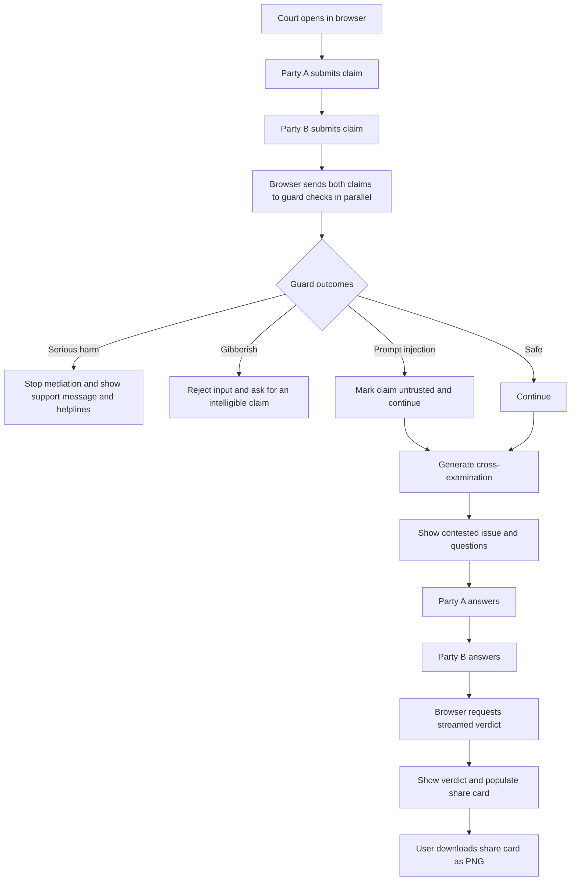
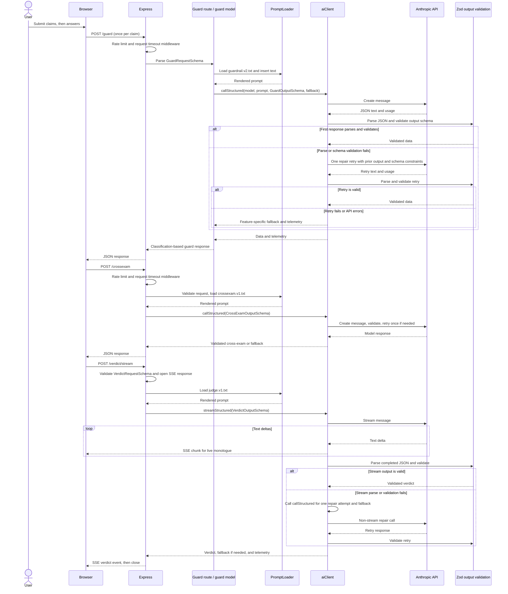

# Argument Settler Architecture

## System overview

Argument Settler is a browser-based comedy courtroom backed by a small Node.js, TypeScript, and Express API. The browser serves the single-page experience from `public/index.html`, gathers both parties’ claims, checks each claim through `/guard`, asks `/crossexam` for questions, collects answers, and requests a streamed verdict from `/verdict/stream`; the final verdict is rendered as a downloadable share card. Express validates incoming data with Zod schemas, loads versioned prompt templates from `prompts/`, and delegates structured generation to a shared Anthropic client. That client parses model JSON, validates every model response, retries once when parsing or validation fails, and then returns a feature-specific fallback. Environment configuration, rate limiting, request timeouts, and error handling are configured around the routes in the app.

## User flow

The browser runs the two `/guard` calls concurrently. A serious-harm result takes precedence; gibberish blocks progression; a prompt-injection classification is warned about but does not block the trial. The backend does not persist a trial session: the browser carries claims and answers between stages.

## API flow

`POST /verdict` uses the same `VerdictRequestSchema` and structured generation path as the stream endpoint, but returns one JSON response. For streaming, raw text deltas are sent to the browser before the completed output has passed JSON parsing and schema validation; the final verdict event is sent only after validation or fallback.

## Components

| `src/` folder | Job | Key files |
| --- | --- | --- |
| `config` | Load and validate runtime environment settings. | `config/env.ts` — dotenv loading, environment schema, and `getEnv()` fallback behavior. |
| `middleware` | Apply request-level limits and time bounds. | `middleware/rateLimiter.ts` — in-memory per-IP fixed-window limiter; `middleware/timeout.ts` — request timeout response. |
| `routes` | Validate endpoint inputs, load the right prompt, call AI services, and shape HTTP/SSE responses. | `routes/court.routes.ts` — `/guard`, `/crossexam`, `/verdict`, and `/verdict/stream`. |
| `schemas` | Define request and AI-output data contracts, enums, types, and safe fallback values. | `schemas/court.schemas.ts` — court request/output schemas and defaults. |
| `services` | Load prompt templates and communicate with Anthropic for structured responses. | `services/promptLoader.ts` — template loading and placeholder substitution; `services/aiClient.ts` — model calls, parsing, validation, retry, fallback, and telemetry. |

The entry points are `src/index.ts` (reads environment and starts the listener) and `src/app.ts` (builds Express middleware, static serving, routes, and error handling); they are files directly under `src/`, not one of the listed folders.

## Data contracts

The Zod contracts are declared in `src/config/env.ts` and `src/schemas/court.schemas.ts`. Request schemas validate browser-to-server data; output schemas validate model data before routes use or return it. Zod object schemas use their default object behavior, so unknown object keys are stripped from parsed output.

| Schema or enum | What it guards |
| --- | --- |
| `envSchema` | `PORT` (string defaulting to `3000`, transformed with `parseInt`), `NODE_ENV` (`development`, `production`, or `test`), and a non-empty `ANTHROPIC_API_KEY`. `getEnv()` bypasses this parse for test/`ALLOW_EMPTY_KEY` mode and uses a development mock key when parsing fails outside production. |
| `GuardRequestSchema` | `/guard` body: trimmed `text`, 1–2,000 characters. |
| `CrossExamRequestSchema` | `/crossexam` body: trimmed judge name defaulting to `Bhide`, and each party claim trimmed, at least 3 and at most 2,000 characters. |
| `CourtLanguageEnum` | Supported verdict languages: `hinglish`, `hindi`, or `english`. |
| `VerdictRequestSchema` | `/verdict` and `/verdict/stream` body: judge name defaulting to `Bhide`, language defaulting to `hinglish`, both trimmed claims of at least 3 characters, and both trimmed answers of at least 1 character. Unlike the cross-exam claims, verdict claims have no explicit maximum here. |
| `GuardClassificationEnum` | Guard categories: `safe`, `serious_harm`, `prompt_injection`, or `gibberish`. |
| `GuardOutputSchema` | Model classification, confidence in the 0–1 range (default `1.0`), non-empty reasoning, and optional nullable caring response. |
| `CrossExamOutputSchema` | Model cross-exam result: each party’s question and the contested-issue summary must be at least 5 characters. |
| `WinnerEnum` | Verdict winner: `PARTY_A`, `PARTY_B`, `SPLIT_FAULT`, or `MUTUAL_CONTEMPT`. |
| `VerdictSentenceSchema` | Verdict sentence: punishment of at least 5 characters and a non-negative integer fine in rupees. |
| `VerdictOutputSchema` | Full verdict: court title at least 3 characters, winner, guilty party (`PARTY_A`, `PARTY_B`, `BOTH`, or `NEITHER`), at least one charge, monologue at least 10 characters, and a valid sentence. |

The exported `FallbackGuardOutput`, `FallbackCrossExamOutput`, and `FallbackVerdictOutput` are typed fallback values, not Zod schemas; `AiClient` returns them after a failed retry. `GuardRequest`, `CrossExamRequest`, `CourtLanguage`, `VerdictRequest`, `GuardClassification`, `GuardOutput`, `CrossExamOutput`, and `VerdictOutput` are inferred TypeScript types rather than additional runtime schemas.

## Failure modes and handling

| Failure | Current handling |
| --- | --- |
| Invalid JSON body fields | Route-level `.parse()` raises a Zod error; app error middleware responds with HTTP 400 and flattened validation details. |
| Malformed JSON syntax or other parser error | Express error middleware only special-cases `ZodError`; other errors are logged and returned as HTTP 500 with the error message. |
| Missing/invalid environment settings | In production `getEnv()` logs configuration errors and throws at startup. In non-production it warns and supplies a mock key. Test/`ALLOW_EMPTY_KEY` mode supplies a test configuration. |
| Missing prompt file | `PromptLoader.load()` throws. The route forwards the error to Express, which logs it and returns HTTP 500. |
| Model response is invalid JSON or fails its output schema | `callStructured()` retries once with a repair prompt; if the retry fails, the route receives the configured fallback and telemetry flags `retried` and `usedFallback`. |
| Anthropic call failure | The first structured-call failure also triggers the one repair attempt; failure on retry returns fallback. A streaming call failure falls back to `callStructured()`, which itself applies this retry/fallback policy. |
| Guard model fallback | `FallbackGuardOutput` classifies as `safe`, so a persistent guard-model failure fails open and allows that claim to proceed. |
| Rate limit exceeded | In production/development, the per-process limiter returns HTTP 429, `Retry-After`, and a JSON message after 30 requests per IP per 15-minute window. It is skipped when `NODE_ENV` is `test`. |
| Request runs beyond timeout | Outside tests, timeout middleware attempts HTTP 504 if headers have not been sent. It does not cancel downstream work. For SSE, headers are already sent before generation, so the middleware’s timeout response is skipped. |
| Stream generation or response error | If headers are not sent, route error handling runs normally. After SSE headers have been sent, the route emits an SSE `error` event and closes. Model text chunks may already have reached the browser before final validation. |
| Browser/network failure | The browser catches submit/stream errors and shows a message in the relevant screen; the share-card download routine has no local error handler. |

## Design tradeoffs and scale changes

| Tradeoff | Current choice and consequence | What to change at scale |
| --- | --- | --- |
| Stateless browser-held trial state | No server-side session store simplifies deployment and avoids storing disputes, but refreshes lose progress and claims/answers are resent to later endpoints. | Introduce short-lived, encrypted session records only if resumability, audit, or multi-device continuity is required; define retention and deletion behavior first. |
| Process-local rate limiting | A `Map` is dependency-free and works for one server process, but limits reset on restart and each replica has a separate count. | Move rate limits to a shared store such as Redis or a managed gateway, with explicit proxy/IP trust configuration. |
| Synchronous model calls in request handlers | Simple request/response orchestration keeps the product easy to run, but requests occupy connections while the model works and timeouts do not cancel the provider call. | Add provider deadlines and cancellation, concurrency controls, queueing for long jobs, and operational metrics before increasing replica count or traffic. |
| Schema repair plus local static fallbacks | One retry improves resilience without exposing unvalidated AI output as the final data, and static fallbacks keep the UI usable; retries increase latency/cost, while the guard fallback allows claims through. | Track per-route validation/fallback rates, tune retry policy by endpoint, and make guard outages fail closed or offer a clearly separate safe mode based on product and safety review. |
| Full model calls for guard, cross-exam, and verdict | Separate prompts keep concerns understandable; the guard uses Haiku and the verdict uses Sonnet, but multiple calls add latency and cost. | Benchmark quality by stage, use cheaper classifiers or smaller models where adequate, cache only safe/repeatable computations, and apply per-user/provider budgets. |

These scale changes are recommendations inferred from the current implementation, not existing roadmap commitments.
